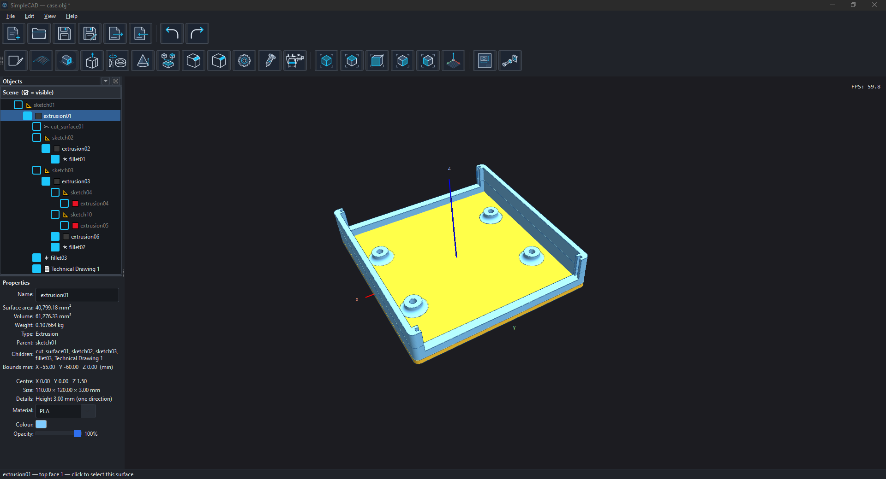
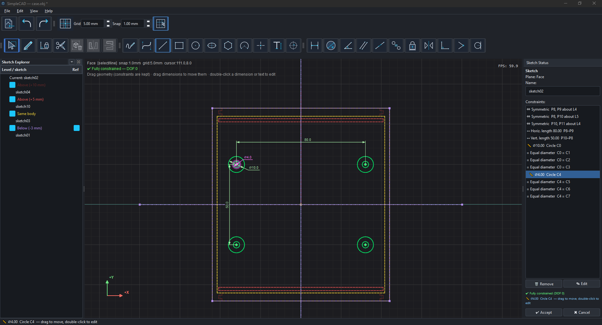

# SimpleCAD
SimpleCAD is an open source construction tool, which it's main idea is to make it's useability as easy as possible. 
Objects are created always with a sketch which can be extruded to different forms and every extrusion itself can hold again a sketch, this makes it clear how the object relationships are.
It also contains an Assembly and Technical Drawing Tool.

<picture>
  <source media="(prefers-color-scheme: dark)" srcset="doc/scad_construction.png">
  
</picture>

### Construction Tools
- Sketcher (create 2D drawings for extrusion, supported by different reference and constraint options or import SVG or DXF files)
- Extrusion (Standard add or remove material perpendicular in sketch direction or extrude on a surface directly)
- Ring Extrusion (Circular add or remove material with a given radius around the Sketch or World plane, with helical mode)
- Surface (add surface plane for a sketch)
- Cut mode (place a plane at which an extrusion will be cut for visibility)
- Draft (creates angled shapes)
- Merge (create bridges between objects e.g. flat surface to rounded surface)
- Chamfers
- Fillets
- Gear generator (Spur, Ring, Planetry, Bevel, Rack, Helical) with an additional counter part
- Thread generator (Customize or Standard metric/imperial threads)
- Measurement

### Additional Tools
- Technical Drawing (creates standarized drawings and export them to PDF, SVG or DXF)
- Assembly (import SimpleCAD objects but also STEP and STL files to create a complete construction)

### Export
- STEP or STL files

## Sketch
<picture>
  <source media="(prefers-color-scheme: dark)" srcset="doc/scad_sketcher.png">
  
</picture>

